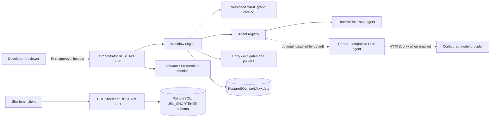

# Agentic SDLC and URL Shortener Architecture

## 1. System context

The project is a local prototype containing two independently started Spring Boot services and one PostgreSQL database. The workflow engine coordinates software-delivery tasks and produces auditable artifacts. The URL shortener is the product workload used by the assignment; it handles user-facing link creation, redirects, and click analytics.

## 2. Runtime components

| Component | Module / package | Responsibility |
| --- | --- | --- |
| Orchestrator REST API | `orchestrator`, `controller` | Starts runs; reports state, timeline, and artifacts; accepts approvals and control actions |
| Graph catalog and validator | `graph`, `service/GraphCatalog` | Loads `graphs/*.yaml` at startup, checks IDs, dependencies, cycles, connectivity, and artifact flow |
| Workflow engine | `service/WorkflowEngine` | Resolves ready nodes, executes independent nodes concurrently, waits at joins, applies gates, retries, persists outputs, and handles controls |
| Transition and persistence services | `service/TransitionService`, `repository`, `entity` | Persist node/run state, audit events, artifacts, lineage, and active versions |
| Gate and policy engine | `gate`, `policy`, `service/PolicyEngine` | Evaluates schema, artifact, quality, approval, and policy rules; unknown policies fail closed |
| Agent registry | `service/AgentRegistry` | Selects the highest-priority registered agent for a graph role |
| Stub agent | `agent/StubAgent` | Deterministic local agent; active when LLM mode is off |
| LLM agent | `agent/OpenAiCompatibleLlmAgent` | Optional structured artifact generation over Chat Completions-compatible HTTP API; has no tools or repository access |
| Metrics | `service/WorkflowMetrics`, Actuator | Emits low-cardinality workflow counters, timers, and histograms at `/actuator/prometheus` |
| Shortener API | `shortener-service`, `controller/ShortUrlController` | Creates links, redirects, validates aliases/URLs/expiry, and serves aggregated click analytics |
| Shortener persistence | `shortener-service`, `entity`, `repository` | Stores short URLs and click rows in schema `URL_SHORTENER` |

## 3. Module and persistence boundaries

### Orchestrator

The `orchestrator` module runs on port 8080. Flyway migrations create:

- `run`: graph name/version, original requirement, status, trace ID, stop flag, timestamps.
- `node_execution`: current state, attempt number, and pending approval outputs per node/run.
- `audit_event`: append-only state and governance event trail.
- `artifact`: immutable artifact versions, SHA-256 content hash, producer, active flag, and input lineage JSON.

The relational model keeps each run tied to its selected graph version while artifacts retain exact upstream artifact identity. Requirement text and run IDs are not used as metric labels.

### URL shortener

The `shortener-service` module runs on port 8081. It shares the configured PostgreSQL database but uses the isolated `URL_SHORTENER` schema and a dedicated Flyway history table. Flyway creates:

- `short_url`: unique short code, target URL, create/expiry times, atomic click counter.
- `short_url_click`: one row per successful redirect, timestamp and optional referrer host.

No client IP address is stored. Analytics are derived from click rows. Flyway creates the schema automatically when the shortener service starts; the database itself must exist first.

## 4. Workflow execution model

1. `POST /runs` validates the requested graph and persists the run plus `PENDING` node executions.
2. The engine computes the DAG's ready set. Each node's declared dependencies must have succeeded.
3. Entry gates run before agent dispatch. The agent receives the raw requirement and only the artifacts listed in that node's `consumes` field.
4. Agent attempts are timed and retried up to the node's `maxRetries`. Outputs must contain every declared artifact type.
5. Exit gates validate outputs before publication. A human-approval gate stores outputs as pending and pauses the run. Approval publishes them and resumes; rejection blocks the run.
6. Published artifacts are immutable, hashed, versioned, and linked to the exact active input artifact IDs, versions, and hashes.
7. All currently ready nodes execute in a forked batch. The engine waits for all branches before computing the next batch, so a join cannot start early.
8. Terminal status and duration are recorded. Retry, approval, rollback, safe-stop, replan, transitions, and gate results are recorded in the audit trail.

## 5. Public interfaces

### Orchestrator (`:8080`)

| Method and path | Purpose |
| --- | --- |
| `POST /runs` | Start a graph run; request has `graph` and `requirement` |
| `GET /runs/{id}` | Read run status and node states |
| `GET /runs/{id}/timeline` | Read audit timeline |
| `GET /runs/{id}/artifacts` | Read artifact versions, hashes, active flags, and lineage |
| `POST /runs/{id}/nodes/{nodeId}/approval` | Approve/reject a waiting node and record actor/reason |
| `POST /runs/{id}/nodes/{nodeId}/retry` | Explicitly retry an eligible failed/rejected/blocked/stopped node |
| `POST /runs/{id}/nodes/{nodeId}/rollback` | Deactivate current node outputs and stale downstream results |
| `POST /runs/{id}/nodes/{nodeId}/replan` | Re-run a node and affected downstream nodes |
| `POST /runs/{id}/safe-stop` | Request a safe stop for a running or approval-waiting run |
| `GET /actuator/health` | Liveness/health endpoint |
| `GET /actuator/prometheus` | Prometheus-format workflow metrics |

### URL shortener (`:8081`)

| Method and path | Purpose |
| --- | --- |
| `POST /api/urls` | Create a short URL; optional `customAlias` and `expiresAt` |
| `GET /{code}` | Return HTTP 302 to the destination and record a click |
| `GET /api/urls/{code}/analytics` | Return total clicks, clicks by referrer host, and daily counts |

Target URLs must be absolute HTTP or HTTPS URLs without embedded user credentials. Aliases are 3–32 characters from letters, digits, `_`, and `-`. Duplicate aliases return 409. Unknown and expired redirect codes return 404.

## 6. Agent and trust boundaries

Stub agents are deterministic and make no external calls. LLM mode is explicitly disabled in `orchestrator/src/main/resources/application.yml`. When enabled by changing `agent.llm.enabled`, the OpenAI-compatible agent is ordered before the stub. It sends the raw requirement and declared input artifact content to the configured provider, requests a JSON object keyed by expected artifact types, and never receives tool execution or filesystem access.

Credential patterns recognized by the current no-secrets policy are blocked before sending prompt data. This is a narrow pattern-based defense, not data-loss prevention. Do not enable a model endpoint for data that provider is not approved to process. API keys should be injected through environment configuration and must not be placed in source, requirements, or artifacts.

## 7. Configuration and deployment assumptions

- JDK 21, Maven 3.9+, PostgreSQL.
- Default local database name: `orchestrator`; database credentials currently live in `orchestrator/src/main/resources/application.yml` and should be externalized outside a local prototype.
- Shortener DB settings: `SHORTENER_DB_URL`, `SHORTENER_DB_USER`, `SHORTENER_DB_PASSWORD`; service port `SHORTENER_PORT`; public link origin `SHORTENER_PUBLIC_BASE_URL`.
- LLM settings: `agent.llm.enabled`, `LLM_BASE_URL`, `LLM_MODEL`, `LLM_API_KEY`, `LLM_CONNECT_TIMEOUT_MS`, `LLM_READ_TIMEOUT_MS`.
- The two modules are started separately. There is no container orchestration, gateway, authentication layer, or TLS termination configuration in this prototype.

## 8. Reliability, observability, and known gaps

Workflow node failures and exit-gate failures have bounded retries. Human decisions are explicit audit events. Rollback deactivates outputs and marks successful descendants stale; replanning re-executes the affected downstream subgraph. Safe-stop prevents new work from starting and marks pending/approval-waiting work stopped. These controls do not provide distributed cancellation of an in-flight provider call.

Micrometer exports workflow totals, outcomes, durations, transitions, gate decisions, attempts, retries, approvals, rollbacks, safe-stops, replans, fork batch size, and artifact counts. The prototype does not yet provide dashboard provisioning, alert rules, durable asynchronous click ingestion, click retention, authentication, provider failover, or production backup/restore automation. See [the decision tables](decision-table.md) for current policy choices and limits.
